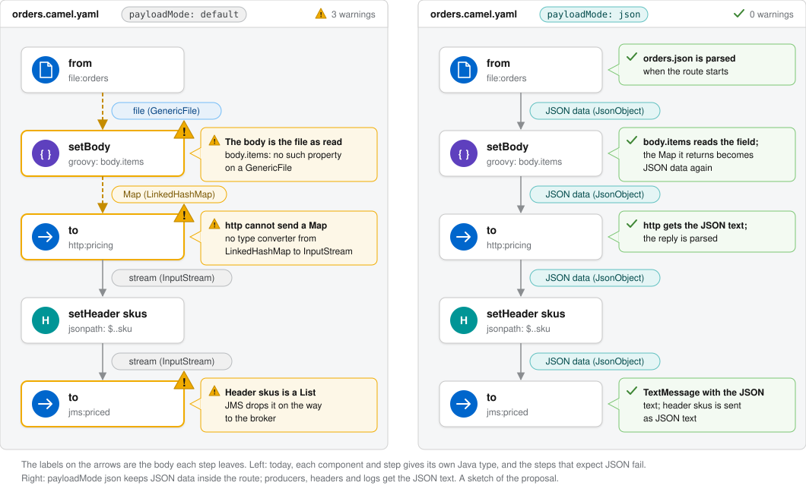

== Summary

A route carries the body as the Java type that each component and each step happens to produce: a `GenericFile`, a
`byte[]`, an `InputStream`, a `Map`, a `String`. Users who think of the payload as JSON (or CSV, or XML) write their
mappings for that shape, and the gap between the two shows up as runtime errors.

This proposal adds an opt-in *payload mode*. With `payloadMode=json` the body inside the route is JSON data (a
`JsonObject` or a `JsonArray`), whatever the component or the step before gave, and at the edges of the route it is
the JSON text. The payload mode is an SPI: JSON is the first plugin, and other text and binary formats (CSV, XML, CBOR,
Avro, ...) can follow as plugins.

The same route with both modes, as a visual route editor could show it with the body types of the catalog:

== Motivation

Low-code users, and AI models writing routes, think of the payload as JSON and write data mappings in Groovy and simple
accordingly. Camel carries the native Java type of each component instead, and that type changes during routing and
from component to component. Examples:

- Groovy `body.find { it.sku == headers.sku }` on JSON that was not unmarshalled fails with
  `No such property: sku for class: java.lang.Byte`.
- simple `${body[amount]}` on the body of the file consumer fails with
  `Key: amount not found in bean: GenericFile[...]`.
- A mapping that returns a `Map`, sent to an http producer, fails: there is no type converter from `LinkedHashMap` to
  `InputStream`.
- A jsonpath result stored in a header as a `LinkedList` disappears when the message crosses a JMS broker.

Raymond Meester described the same from the Fluxygen low-code platform built on Camel, where users write Groovy and
simple without knowing Java (Zulip thread "Text-orientated vs. Object-orientated in integration"). In the local-model
benchmark, 19 of 156 attempts in one series failed on such a body type collision.

The hints of CAMEL-25330, CAMEL-25746 and CAMEL-25749 now say what to do in each of these cases ("unmarshal it
first"), but nothing does it: a user still has to know which step gives which Java type, and where to unmarshal and
marshal.

== Goals

- A route can opt in to work on the payload as data of one format: JSON first.
- Inside such a route, the body has one predictable shape: Groovy `body.sku`, simple `${body.sku}` and
  `${body[sku]}`, split and aggregate work on it without unmarshal and marshal steps. Reading a few fields of the
  payload needs no jsonpath, jq or JSON parsing code in Groovy: `body.sku` reads better than their syntax.
- At the edges (producers, header values, what users see in logs and tooling) the payload is its text, or its bytes
  for a binary format.
- Formats are plugins of one SPI, so CSV, XML and binary formats can be added without changing the engine.
- Routes that do not opt in behave exactly as today.

== Non-goals

- Changing the default behaviour of Camel. The mode is opt-in, per `CamelContext` and per route.
- The lowest overhead. The mode parses and writes payloads that a hand-written route might pass through untouched; it
  is for routes where predictability matters more than raw speed.
- Mapping arbitrary Java objects (SDK objects, entities) to JSON. They stay as they are; a JSON writer SPI can come
  later.
- Schemas and validation of the payload.

== Current design

- The body is whatever the last step set. Consumers and producers document their body types in the catalog
  (CAMEL-24961), and the validator follows them through a route (CAMEL-24844, CAMEL-25928), but at runtime nothing
  normalizes the body.
- Reading fields needs an `unmarshal` step first. When it is missing, the Groovy language, the bean OGNL of simple,
  jsonpath, jq and several producers say so in their error (`BodyFacts`, CAMEL-25749).
- Some JSON support already exists in core without Jackson: camel-util-json (`JsonObject` extends `LinkedHashMap`,
  `JsonArray` extends `ArrayList`, `Jsoner` parses and writes), type converters from a `String`, `byte[]`,
  `InputStream`, `File` and `WrappedFile` to `JsonObject` / `JsonArray` in camel-support (`JsonConverter`; there are
  none in the other direction), and the `${simpleJsonpath(...)}` function of simple.
- Stream caching is the precedent for an opt-in mode that changes the body: it is enabled per `CamelContext` and per
  route (`RuntimeConfiguration#setStreamCaching`, the `streamCache` option of a route), and works through an advice
  where the consumer hands the message to the route (`CamelInternalProcessor`) and around every step
  (`DefaultChannel`).

== Proposal

=== The option

`payloadMode` is a new option of the `CamelContext` and of a route, like stream caching:

- `camel.main.payloadMode = json` for all the routes, and a route can set its own `payloadMode` to opt in or out.
- The value is the name of a payload mode plugin. `default` (the default) means no payload mode: today's behaviour.
- A route has one payload mode. The value is a single name, so a list (`json,csv`) can be added later without
  breaking it.
- `payloadModeStrict` (off by default) makes the route accept only payloads of its mode from the consumer:
  `camel.main.payloadModeStrict = true` for all the routes, and a route can set its own `payloadModeStrict` to turn
  it on or off (see the strict mode in the engine).
- A route that does not set its own `payloadMode` follows the payload mode of the exchange, so a utility route that
  other routes call with `direct` acts as its caller (see the exchange's payload mode in the engine).

=== The SPI

A payload mode is a plugin found by its name, like data formats and languages
(`META-INF/services/org/apache/camel/payload-mode/<name>`), or bound in the registry. It is marked preview in its first
release, so the interface can still change when the second plugin arrives.

[source,java]
----
public interface PayloadMode extends Service, CamelContextAware {

    /** The name, such as json, csv, cbor. */
    String getName();

    /**
     * The content types of the payloads of this mode, such as application/cbor and application/x-cbor. The first is
     * the one this mode writes.
     */
    List<String> getContentTypes();

    /** Whether the value is data of this mode (for json: a JsonObject or a JsonArray). */
    boolean isData(Object value);

    /** Whether the body is a payload of this mode, which toData turns into data. */
    boolean isPayload(Exchange exchange, Object body);

    /**
     * The payload as data of this mode. Only called when isPayload is true; throws when the payload does not parse.
     */
    Object toData(Exchange exchange, Object body) throws Exception;

    /** A copy of the data, so the branches of an EIP that copies the exchange do not share it. */
    Object copy(Object data);

    /** The wire form of the data: a String for a text format, a byte[] for a binary one. */
    Object toPayload(Exchange exchange, Object data);

    /** The data as readable text, for logs, tracing, tooling and header values. */
    String toDisplay(Exchange exchange, Object data);
}
----

A payload mode is a service with the lifecycle of a data format: it is started with the routes that use it and
stopped with them, and it can have options (an Avro or Protobuf schema), configured like a data format. A plugin with
nothing to start, such as json, gets the lifecycle from the base class.

A base class in camel-support holds the rule that is the same for every format, so a plugin declares its content
types and file extensions, and brings its parser, its writer and its copy:

- `isPayload` reads the `Content-Type` header (and its `charset`), the file name through `MimeTypeHelper` when there is
  no `Content-Type`, and a sniff of the content that a plugin can override (the first character for a text format,
  magic bytes for a binary one)
- the engine calls `toData` only when `isPayload` is true, so there is no "not mine" result to check. When it throws,
  the engine leaves the body as it is and logs at DEBUG: by default the mode never fails a message (see the strict
  mode in the engine for a route that wants it to)
- a stream that stream caching has spooled to disk is not a payload: the spool threshold is the size limit, so the
  mode has no size option of its own

=== The engine

The engine part does not depend on the format.

*The exchange's payload mode.* Where a route consumer creates an exchange, the payload mode of that route (its own, or
the global one) is marked on the exchange, in the exchange extension (not a property, so a route cannot remove it by
accident). The copies of an exchange (`seda`, multicast, recipient list, split, wire tap) carry the mark. A route then
works under:

- its own `payloadMode`, when it sets one. `payloadMode=default` opts a route out, such as a route of Java helpers that
  wants the Java types of the components;
- otherwise the mode of the exchange, so a utility route that several routes call with `direct` acts as its caller:
  in `json` mode for a json route, and as today for a route without a mode;
- otherwise the global mode, for an exchange that no route consumer created, such as one sent with a
  `ProducerTemplate`.

When the exchange comes back from a route with a mode of its own, the caller's mode applies again after the step that
called it. The type converters at the edges and the JMS binding read the mode from the exchange too.

*Which bodies become data.* Where the consumer hands the message to the route, and after every step, the body is
given to the route's mode (where stream caching works today): when it `isData` already it is left alone, and when it
`isPayload` it is turned into data with `toData`. So one rule covers the body of a consumer, the reply of a producer and the result of
any step, including a language, `process`, `bean`, split and aggregate, and a route that stays in its data costs a
type check per step.

The steps of the error paths are steps too: `onException`, `doTry` / `doCatch` / `doFinally` and the error handler
have a channel like any other step, so the hook runs there as well. A body that is not a payload, such as an exception
or an error text, is left as it is.

*A stale `Content-Type`.* The `Content-Type` header that came with a payload stays on the message when a step turns
the payload into another format, such as JSON that a `marshal` writes as XML, or an xslt. The data formats set the
header of what they write (`contentTypeHeader`, on by default), but a language or an xslt step does not. So after a
step that changed the body, a body that does not parse although the header names one of the mode's content types is
not a broken payload but a stale header: the body is left as it is and the header is removed (logged at DEBUG), so a
producer does not send XML as `application/json`.

*The strict mode.* By default the mode never fails a message: a body that is not a payload of the mode, or does not
parse, is left as it is. A route with `payloadModeStrict` accepts only payloads of its mode from the consumer, so in
`json` mode only valid JSON. Before the first step, a body that is not data of the mode fails the message with an
`InvalidPayloadException`, whose hint says why: the parse error of invalid JSON, or the Java type and `Content-Type`
of a body that is not JSON at all (a CSV file in a json route, an object of a component's SDK). The check runs in the
channel of the first step, inside the error handler, so `onException` and the error handler of the route handle it
like any failed message, and an http consumer answers with an error. A null or empty body passes (a timer, an http
`GET`): there is no payload to check. Only what comes in at the consumer is checked: after a step, a body that is not
data is the route's own doing (a step that writes XML), and is left as it is.

*Copies of the exchange.* Multicast, recipient list, wire tap and split give each branch a copy of the exchange, and
the copies would share the same mutable data, so a branch that changes a field would change it for the others. Where
these EIPs copy a `StreamCache` body for each branch today (`MulticastProcessor`, `WireTapProcessor`), they call
`copy` of the payload mode for data, so each branch gets its own.

*The edges.* Producers get the payload through the type converter, not by replacing the body before them:

- type converters give the payload when the target is a `String`, `byte[]` or `InputStream`. For the json mode these
  are the regular type converters of camel-support from `JsonObject` and `JsonArray` to their JSON text (CAMEL-26324),
  which act in every route, with or without a payload mode. A plugin whose data type has no such converters adds a
  fallback type converter that gives `toPayload` (and `toDisplay` for a `String` from a binary format) when the value
  is data of the exchange's payload mode. So http, file, kafka and the other producers that read text, bytes or a
  stream get the payload.
- producers that take a `Map` as their API use the data: sql named parameters (`:#sku`, `SqlHelper` converts the body
  to a `Map`), mongodb documents.
- producers that would turn a `Map` into something that is not the payload are fixed to ask the payload mode first:
  JMS and SJMS send a `Map` as a `MapMessage` (`JmsBinding`), and send data of a payload mode as a `TextMessage`
  (`BytesMessage` for a binary mode). Other producers of this kind are found by a survey of the components.
- before a remote producer (`Endpoint#isRemote()`), header values that are data of the mode, a `Map` or a `List`
  become their `toDisplay` text (not the `Camel*` headers, some of which are maps on purpose), so they survive a JMS
  or Kafka hop; and the `Content-Type` header is set to the first of the mode's content types unless it is already
  one of them.
- local endpoints (`direct`, `seda`) pass the data as it is to the next route, which works under its own mode or the
  mode of the exchange (above).

*What users see.* `MessageHelper` (the body in logs, tracing, the backlog tracer and the dev consoles, so also Camel
TUI and the MCP tools) shows `toDisplay` of data of a payload mode, so users see the JSON text, not
`{sku=CAMEL-MUG, qty=3}`.

=== Type converters, data formats and body types

A payload mode is a stage of its own, not a type converter, and it does not replace the type converters or the data
formats:

- Inside the route the engine hook turns payloads into data, at the spots of the stream caching advice. A type
  converter only runs when a step asks for a type, so it cannot keep the body as data from one step to the next; the
  hook can.
- At the edges the json mode needs no type converter of its own: the regular type converters from `JsonObject` and
  `JsonArray` to a `String`, `byte[]` or `InputStream` give the JSON text (CAMEL-26324). A plugin whose data type has
  no such converters adds a fallback type converter, which only acts on exchanges of a route with a payload mode (see
  the edges above). The other type converters are left as they are.
- A conversion inside the route uses the type converters as today: `convertBodyTo`, `${bodyAs(...)}` and the
  parameter binding of a bean. Data of the json mode is a `Map` or a `List`, so a conversion to `Map` gives it as it
  is, and a conversion to `String` gives the JSON text through the converters of CAMEL-26324 above (not the
  `toString` of a `Map`); a conversion to another type goes through the type converters that exist today.
- The data formats do not change: `marshal` and `unmarshal` do what they do today, and their result is handled like
  the result of any other step (see what changes for route authors below).
- The body types the catalog declares stay the Java types the components give. The validator applies the payload mode
  on top of them (see tooling below).

=== The json plugin

In camel-support, with camel-util-json, so it needs no new dependency.

- Data: `JsonObject` (a `LinkedHashMap`, so the field order is kept) and `JsonArray`; numbers are `BigDecimal`.
- Payloads: a `String`, `byte[]`, stream or file whose `Content-Type` is `application/json` or `*+json`, or with no
  `Content-Type` whose file name ends with `.json` or whose text starts with `{` or `[`; and a `Map` or a `List` that
  converts as below. Any other body is left as it is.
- `toData` parses the text, and converts a `Map` to a `JsonObject` and a `List` (or an array) to a `JsonArray`, with
  their nested values:
** a `String`, `Number`, `Boolean` and null stay as they are
** a nested `Map`, `List` or array is converted the same way
** a `java.util.Date`, a `java.sql.Timestamp` and the `java.time` values become their ISO-8601 text, so the rows of
   sql (with their `Timestamp` columns) become JSON data
** an enum becomes its name, a `UUID` its text, and a `byte[]` its base64 text
** any other object (a POJO), or a reference back to a map or list that contains it, is not JSON data: the whole
   `Map` or `List` is then not a payload, and is left as it is
- `copy`: a deep copy of the `JsonObject` or `JsonArray` (their values are JSON values, so the copy is plain).
- `toPayload` and `toDisplay`: the JSON text (`Jsoner`).

So in a route with `payloadMode=json`, with no change to the languages or the EIPs:

- Groovy `body.sku`, `body.items.each { ... }`, `body.find { ... }` work on the `Map` and `List`
- simple `${body.sku}` and `${body[sku]}` work (the bean OGNL reads a key of a `Map`)
- split of a `JsonArray` gives its elements, each a `JsonObject`; aggregating them gives a `List`, which becomes a
  `JsonArray`

=== A route with more than one format

A route is rarely one format. Raymond Meester's order route from the review of this proposal reads JSON files and
sends XML to a SOAP service. In `json` mode the JSON part is data, and the XML part is left as it is today:

[cols="1,2,2"]
|===
|Step |What it does |The body in `json` mode

|`from: file` (`.json` files)
|reads an order
|a `JsonObject` (by the file name)

|`log`
|logs the order
|the JSON text in the log (`toDisplay`)

|`split` by jsonpath `$.lines[*]`
|one message per order line
|each a `JsonObject` (jsonpath gives a `LinkedHashMap`, which becomes data)

|`setBody` with Groovy `[sku: body.sku, qty: body.qty * 2]`
|maps the line
|a `JsonObject`, with no `JsonSlurper`

|`marshal` with `jacksonXml`
|JSON to XML
|a `byte[]` of XML with `Content-Type: application/xml`, which is not JSON and is left as it is

|`log`
|logs the XML
|the XML text, as today

|`to: xslt`
|transforms the XML
|an XML `String`, as today

|`to: spring-ws`
|calls the SOAP service
|the XML text
|===

The JSON to XML step is still a `marshal` through a data format; a step that converts one text format to another
(JSON to XML, CSV to JSON) is a topic of its own. What the `json` mode leaves out: an XML or CSV payload that arrives
at the consumer (a `.xml` file) is not JSON, so it stays a `GenericFile`. The text plugin (below) and more than one
mode per route (`payloadMode=json,text`, an open question) close that gap.

=== Other formats, on paper

These are not part of the first work. They are here to check that the SPI does not only fit JSON.

[cols="1,2,2,3"]
|===
|Format |Module |Data in the route |What it tells the SPI

|CSV
|camel-csv (commons-csv)
|the rows as a list of maps, keyed by the header line
|A plain `List` is not specific enough for `isData`: the plugin needs a marker type (such as a `CsvRows` that extends
`ArrayList`). Detection needs the `Content-Type` or the file name, the text cannot be sniffed reliably.

|XML
|camel-xml-jaxp
|a DOM `Document` (Groovy GPath, xpath)
|XML does not fit the JSON data model (attributes, namespaces, mixed content), so the data type must be per plugin.

|CBOR, MessagePack, Smile, BSON, Ion
|camel-cbor, and new ones
|the JSON data model, so `JsonObject` / `JsonArray` too
|A binary wire form: `toPayload` gives a `byte[]` and `toDisplay` the JSON text. Two plugins can share a data type, so
writing at an edge uses the route's mode, not the type of the data (see the open question on the regular type
converters). Detection by `Content-Type` and magic bytes.

|Avro, Protobuf, Thrift, ASN.1
|camel-avro, camel-protobuf, camel-thrift, camel-asn1
|a `GenericRecord` / `DynamicMessage`, or the JSON data model through the format's JSON mapping
|A plugin needs options (the schema).

|Text
|camel-support
|a `String` for a text payload (JSON, XML, CSV, plain text), a `byte[]` for a binary one
|Not a data model but the wire form: `copy` returns the same object (it does not change), and a `Map`, `List` or DOM
`Node` that a step returns becomes text by the `Content-Type` (JSON for a `Map` or `List` by default, XML for a
`Node`). Fields are read with jsonpath, xpath or jq, so it does not give `body.sku`. It fits routes built from steps
that read and write text, as on the Fluxygen platform, and the second mode of a route (`payloadMode=json,text`).
|===

Parquet is a file format of many rows, not a message payload, and is not a candidate.

=== What changes for route authors in a payload mode

- A step that produces JSON text has it parsed back into data, `convertBodyTo: String` too. The text inside the route
  is `${bodyAs(String)}`, or `body.toJson()` in Groovy.
- `unmarshal: json` gives a `Map`, which becomes data; `marshal: json` gives text, which becomes data again. Both are
  no longer needed. They do no harm to the result, but `marshal: json` costs a write and a parse back for nothing:
  `${bodyAs(String)}` is the cheap way to the JSON text inside the route.
- Groovy code that parses the body itself, `new JsonSlurper().parseText(body)`, fails: the body is already data, and
  `body.sku` is the field. The hint of the Groovy language (CAMEL-25749) says so in a payload mode.
- An `unmarshal` to a class (a POJO) stays a POJO: other Java objects are left as they are.
- Java code (`process`, `bean`) that expects the Java type of a component gets the data of the mode.

=== Tooling

- The body flow of the validator (CAMEL-24844) knows the payload mode: in `json` mode the body of a file consumer is
  JSON data, and the "unmarshal it first" warnings do not apply.
- The catalog documents the `payloadMode` option, and the body types of the payload modes.
- Camel TUI and the MCP tools show the mode of a route.
- The tracer, the backlog tracer and the dev consoles show the format of the body (JSON for data of the mode, or the
  `Content-Type`) next to its Java type.

=== Order of work

. camel-core, on its own first: the type converters from `JsonObject` and `JsonArray` to their JSON text
  (CAMEL-26324), which are useful without a payload mode.
. camel-core: the `payloadMode` and `payloadModeStrict` options (camel-api, camel-main, the model and the YAML and
  XML DSLs), the SPI and its base class, the engine (the hooks, the copy for the branches of an EIP, header values, display), the json plugin, a
  user manual page, and tests that run the examples of the motivation in both modes. The fallback converter for
  plugins without regular converters comes with the first such plugin.
. Components: JMS and SJMS, and the survey of the producers that turn a `Map` into something else.
. Tooling: the validator, the catalog, Camel TUI and the MCP tools.
. Measure: the local-model benchmark with the mode off and on, comparing the body type collisions and the pass rate.

== Alternatives considered

- *The body as JSON text (a `String`), parsed by each language when it reads it.* Every read parses again (or needs a
  cache), split of a `String` splits on commas, and the languages, split and aggregate all need to learn the mode.
  JSON data in the route gives the same to users with no change to them. Reading a field of a text body needs
  jsonpath, jq or JSON parsing code in Groovy (`new JsonSlurper().parseText(body)`) instead of `body.sku`. For routes
  built from steps that read and write text, this is still useful as a plugin of its own (text, in the formats on
  paper).
- *Converting only at the endpoints.* Most of the drift happens inside the route: a Groovy or `process` step that
  returns a `Map`, split, aggregate. Those would keep the drift.
- *Not converting the body, and letting each reader see a text view of it.* Cheapest, but the body's type is not
  predictable, and logs and tooling show whatever type it has.
- *Replacing the body with its text before every producer.* Breaks the producers that take a `Map` as their API, such
  as sql named parameters.
- *A switch per language.* The problem is the body between the steps, not one language.

== Compatibility

- Nothing changes for routes without a payload mode. The mode is opt-in, and `default` is today's behaviour, so
  existing applications run as they are, with the `unmarshal` and `marshal` steps and the Java types they use today.
- `JsonObject` and `JsonArray` convert to their JSON text in every route with CAMEL-26324. Before, a `String` was
  the `toString` of the map (`{sku=CAMEL-MUG}`, which is not JSON), and there was no conversion to a `byte[]` or
  `InputStream`. This is the one change outside the mode, and it is in the upgrade guide of 4.24. A `JsonObject` that
  holds a value that is not JSON, such as a POJO, converts as before.
- No exchange is marked when no payload mode is configured, so a route that does not set a mode acts as today.
- The fallback type converter of a plugin without regular converters only acts on exchanges with a payload mode.
- The JMS and SJMS change only applies to data of a payload mode.

== Risks

- The data is mutable. The EIPs that copy the exchange copy the data too (see the engine), but a Java `process` or a
  custom `AggregationStrategy` that hands the same data to two exchanges still shares it, as with a `Map` body today.
- A route without a mode of its own that is called from a json route works in `json` mode: Java code in it that
  expects the Java types of the components gets data. `payloadMode=default` on that route opts it out.
- Copying the data for each branch costs a deep copy per branch, which fits the non-goal of the lowest overhead.
- Producers that turn a `Map` into something other than the payload, and are not found by the survey, send the wrong
  thing in the mode.
- Detection by sniffing can be wrong (a text that starts with `[`). The `Content-Type` wins, and a parse failure leaves
  the body as it is, unless the route is strict.
- The SPI is designed with one plugin. Marking it preview, and the formats on paper above, keep it open to change.

== Open questions

- Should a route be able to have more than one payload mode (`payloadMode=json,csv`), each claiming its payloads by
  content type, with a `Map` from a step going to the first? `json,text` would give JSON data for JSON payloads and
  text for XML, CSV and plain text ones, so a non-JSON file is not left as a `GenericFile`.
- Regular type converters run before fallback converters, so at an edge the JSON text converters of `JsonObject`
  would win over a binary plugin (such as CBOR) that shares the JSON data model. The mark of the exchange's payload
  mode gives the converter what it needs to hand the conversion to that mode when the mode claims the data (the
  converter gets the exchange); the other way is a data type of its own for each binary plugin.
- The marker type for CSV rows, and the data type of XML (DOM, or a Groovy-friendly view).
- Should the strict mode also check the reply of a producer, such as an http call that answers with an HTML error page?

== Related tickets

- CAMEL-25334: the payload mode (this proposal).
- CAMEL-24844: the body type flow of the validator.
- CAMEL-25330, CAMEL-25746, CAMEL-25749: the hints when a body is not the data a step reads.
- CAMEL-25329: marshal json writes JSON text as it is.
- CAMEL-26324: type converters from `JsonObject` and `JsonArray` to their JSON text.
